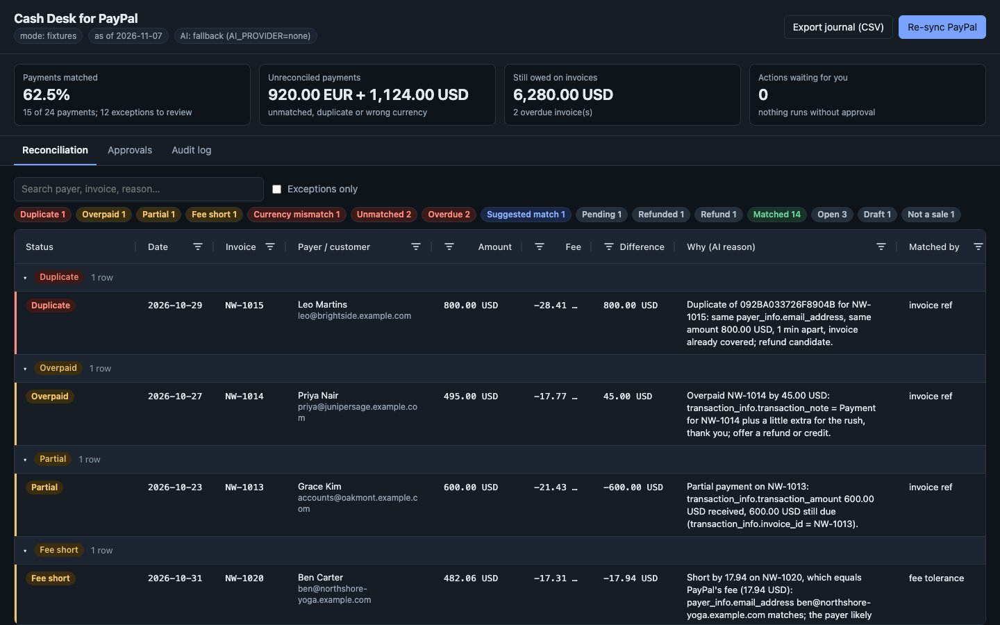
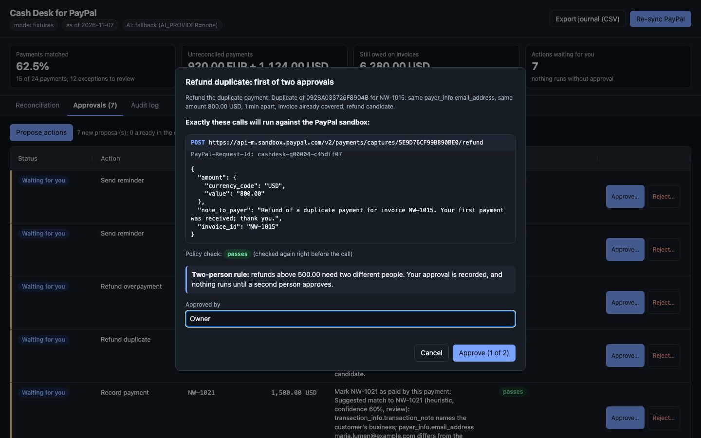
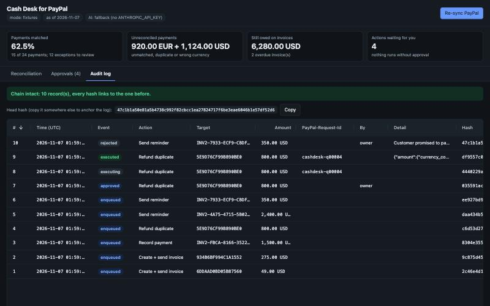

# Cash Desk for PayPal

**An AI reconciliation and collections desk for small businesses that get paid through PayPal.**
It pulls PayPal transactions and invoices, matches every payment to an invoice, explains every
match and every exception in plain words, and proposes the next actions: payment reminders, draft
invoices for money nobody billed, recording a payment, refunding a duplicate. Nothing moves money
on its own. Every action passes a policy check and a human approval, runs with a PayPal idempotency
key, and lands in a hash-chained audit log you can verify.



## Try it in one command (no keys needed)

```bash
make demo          # installs into .venv, serves http://localhost:8000 with sample data
```

- Port 8000 busy? `make demo PORT=8010`.
- Needs Python 3.11+. It uses `uv` when installed, otherwise `venv` + `pip`.
- The demo runs on **Northwind Studio**, a fictional design agency with 26 invoices and 26 PayPal
  transactions that cover every case a small business hits (see [fixtures/README.md](fixtures/README.md)).

Other commands:

```bash
make test          # 240+ tests: matcher, AI layer (mocked), policy, queue, audit, API, UI contract
make audit-verify  # verifies the hash chain of var/audit.jsonl
make eval          # scores reconciliation against the expected outcomes in evals/match_eval.json
```

### A two-minute tour

1. **Reconciliation** groups every payment and invoice by status, with exceptions first:
   duplicate, overpaid, partial, fee short, currency mismatch, unmatched, overdue and suggested match.
   Each row has a one-line reason that cites the PayPal fields it relies on. Click a row to see the evidence.
2. **Approvals → Propose actions.** The agent proposes six actions. **Approve…** shows exactly
   which sandbox call will run: method, full URL, JSON body and `PayPal-Request-Id`. The action
   runs only after you confirm. **Reject…** takes a note.
3. **Audit log** shows every proposal, approval, rejection and PayPal call, plus a banner that
   verifies the hash chain and the head hash to copy elsewhere.



## The problem

A small business paid through PayPal ends every month with a pile of questions:
- Which invoice was this payment for?
- Why is this one $17.94 short?
- Did this customer pay twice?
- Who still owes us, and how late are they?
- Who sent this $275 with no invoice behind it?

PayPal has all the data, split across Transaction Search and Invoicing. Answering those questions is
manual spreadsheet work, and fixing the problems (reminders, refunds, missing invoices) means
clicking through several screens. Cash Desk does the matching and the explaining. It also queues
the fixes for a person to approve.

## How it works

```text
PayPal (sandbox)                Cash Desk                                         Board (AG Grid)
-----------------    ----------------------------------------------------------   ----------------
Transaction Search -> ingest -> SQLite -> rules matcher -> AI layer (Claude) --->  Reconciliation
Invoicing v2       ->                     (evidence)       resolve + explain       grid + detail
                                                 |
                                                 v
                                         action proposer -> policy check -> approval queue
                                                                                   |  human approves
                                                                                   v
                     PayPal write  <- executor (PayPal-Request-Id) <- policy re-check
                                                 |
                                                 v
                                     hash-chained audit log (var/audit.jsonl)  ->  Audit tab
```

**Matching** (`cashdesk/matcher.py`) is deterministic and tries rules in this order:
1. **Invoice reference.** `cart_info.paypal_invoice_id`, `transaction_info.invoice_id`, or the invoice number in the payer's note.
2. **Exact amount plus payer email.** It must point to exactly one open invoice.
3. **Fee tolerance.** The payer deducted PayPal's fee.

Running totals per invoice then classify each payment as matched, partial, overpaid or duplicate.
A duplicate is the same payer paying the same amount within 24 hours of a payment that already
covered the invoice. Currency mismatches, refunds, pending payments and bank withdrawals are
classified separately. When the rules aren't sure, they don't guess: an ambiguous match stays
unmatched, with its candidate invoices, for the AI.

## What the AI does

The AI layer is in `cashdesk/ai.py`, with the prompt in `cashdesk/prompts/reconcile_system.md`.

- **Model:** `claude-sonnet-5-5` through the official Anthropic SDK. It makes one request per
  reconciliation with structured JSON output and low effort. Server-side refusal fallback is on
  (`fallbacks: "default"`), so a declined request is retried on another model inside the same call.
- **Job 1, resolve.** For each payment the rules couldn't place, Claude may pick one invoice
  from that payment's candidate list. Example: the owner of Lumen Bakery paid from a personal address,
  and only the memo links the payment to the invoice.
- **Job 2, explain.** Claude writes a one-line reason for every result, citing the PayPal evidence fields.
- **Guard rails:**
  - Claude only suggests.
  - A link is kept only if the invoice was one of the candidates, the currency matches and the
    confidence is at least 0.6. It then goes back through the deterministic matcher.
  - Suggested matches are marked "needs review".
  - A reason is kept only if every field it cites exists in the evidence.
  - Text written by payers (notes, subjects) is passed to the model as untrusted data.
  - The AI layer has no path to any PayPal write.
- **No key? It still works.** Without `ANTHROPIC_API_KEY`, or on an API error, a refusal or
  invalid output, a deterministic fallback takes over. It is a memo heuristic plus templated reasons.
  The board shows which one ran (`AI: fallback …` or `AI: ai (claude-sonnet-5-5)`).
- `make eval` scores 31 expected outcomes. The fallback scores 31/31 on the sample data. Set
  `ANTHROPIC_API_KEY` to score Claude. That makes one real API call.

## Safety design

| Layer | What it does | Code |
|---|---|---|
| Proposals only | The agent writes proposals that carry the exact PayPal calls; it can't execute | `cashdesk/actions.py` |
| Policy | Checks the allowlist (four actions only), positive amounts in USD or EUR, per-action caps (refunds ≤ 1,000; record payment ≤ amount still owed), call integrity (method, path, body amounts must equal the proposal; no host or path tricks), a rate cap (10 per hour), one live action per target, no reuse of a `PayPal-Request-Id`, and 24-hour expiry | `cashdesk/policy.py` |
| Approval queue | A human approves or rejects each action. The policy runs again at approval and again right before the PayPal call, against the proposal as stored. Rejected, expired, blocked or unapproved items never execute (tested). | `cashdesk/queue.py` |
| Idempotency | Every call carries `PayPal-Request-Id: cashdesk-<item>`. A retry never double-refunds, and an executed item returns its stored result. | `cashdesk/queue.py` |
| Audit | Append-only JSONL. Each record holds the sha256 of its canonical JSON and the previous hash, and a head pointer catches truncation. `make audit-verify` reports the first bad record. Secret-looking fields are redacted. | `cashdesk/audit.py` |
| Sandbox only | The client refuses any base URL other than `api-m.sandbox.paypal.com` | `cashdesk/config.py` |

## PayPal APIs used

All endpoints and response shapes are taken from PayPal's official OpenAPI specs and reference pages.
See [docs/paypal-api-notes.md](docs/paypal-api-notes.md). The sample data matches those schemas
field for field, and a test walks every key.

| API | Endpoint | Used for |
|---|---|---|
| OAuth2 | `POST /v1/oauth2/token` | client-credentials token |
| Transaction Search | `GET /v1/reporting/transactions` | payments, fees, refunds (31-day windows, `fields=all`) |
| Invoicing v2 | `GET /v2/invoicing/invoices` | invoices, amounts due, recorded payments |
| Invoicing v2 | `POST /v2/invoicing/invoices` | draft an invoice for an unbilled payment |
| Invoicing v2 | `POST /v2/invoicing/invoices/{invoice_id}/send` | send that invoice |
| Invoicing v2 | `POST /v2/invoicing/invoices/{invoice_id}/remind` | payment reminder for an overdue invoice |
| Invoicing v2 | `POST /v2/invoicing/invoices/{invoice_id}/payments` | record a payment the AI matched |
| Payments v2 | `POST /v2/payments/captures/{capture_id}/refund` | refund a duplicate payment |

## Run it against the PayPal sandbox

1. Sign in at <https://developer.paypal.com>, open **Apps & Credentials** (Sandbox), and use the
   classic REST app: the **Default Application**, or any app whose client ID starts with `A`.
   Newer app types (client ID starting with `B`) were not granted Invoicing or Transaction Search in our tests.
2. In the app's settings, enable **Invoicing** and **Transaction search**. Without them the token lacks those scopes, and Cash Desk says so.
3. Copy `.env.example` to `.env` and fill in `PAYPAL_CLIENT_ID=` and `PAYPAL_CLIENT_SECRET=`.
   `.env` is gitignored, so never commit it.
4. Run `make demo`. With keys present the mode defaults to `PAYPAL_MODE=sandbox`. Force sample data
   with `PAYPAL_MODE=fixtures make demo`.
5. Optional: add `ANTHROPIC_API_KEY=` for live AI matching and reasons.

Sandbox notes:
- New transactions can take up to about 3 hours to appear in Transaction Search, so payments
  recorded on invoices are read from Invoicing as a second source.
- Amounts are strings handled as `Decimal`, never floats.

## What's new (hackathon period)

Everything. This repository was started on **2026-11-07** for the PayPal AI Hackathon. The ideas
come from the author's earlier Cash Desk work: matching first, AI only suggests, a human approves.
The code was written fresh here, along with the PayPal integration, the policy-gated agent, the
audit chain and the AG Grid board.

## Project layout

```text
cashdesk/            app code: models, paypal/ (interface, parser, fixture client), store, matcher,
                     ai, actions, policy, queue, audit, service, app (FastAPI)
static/index.html    the board: AG Grid Community 36.2.0 from jsdelivr, no build step
fixtures/            Northwind Studio sample data in PayPal's response shapes, plus cases.json
evals/               expected outcomes for make eval
tools/               fixture generator, spec key extractor, eval runner
docs/                PayPal API notes, screenshots
tests/               pytest suite
```

More screenshots: [approvals](docs/screenshots/b3-approvals-grid.jpg) ·
[audit + summary](docs/screenshots/b4-audit-and-summary.jpg) ·
[light mode](docs/screenshots/b5-light-1280-server-down.jpg)



## Licence

MIT, see [LICENSE](LICENSE). PayPal, AG Grid and Claude are named only as the integrations they
are; no brand marks are used.
